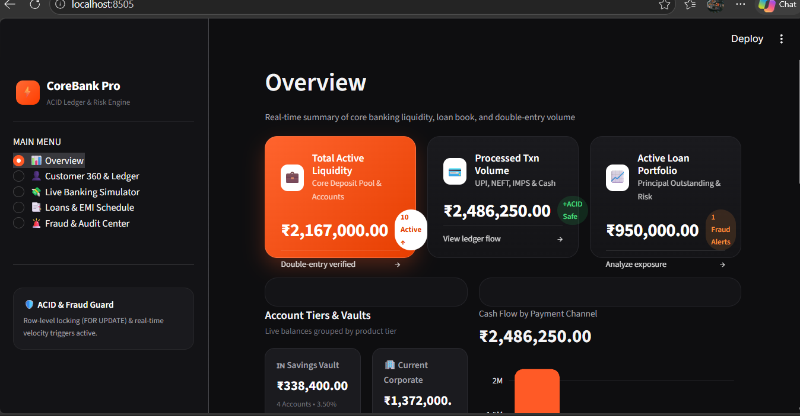

# 🏦 Mini Core Banking System — SQL Database Engineering & Live Risk Dashboard

An end-to-end **Core Banking Database Management & Transaction Monitoring System** built with **MySQL, Python, and Streamlit**. Designed to simulate real-world retail banking workflows including double-entry accounting, ACID-compliant fund transfers, loan amortization schedules, role-based access control, automated audit trails, and real-time fraud detection.

---

## 📸 Dashboard & Database Architecture

### Live Streamlit Executive Dashboard


### 16-Table Normalized ER Diagram


---

## ✨ Key Engineering Highlights

* **16-Table Normalized Schema (3NF):** Covers customers, KYC compliance, branches, multi-account types, beneficiaries, debit cards, transactions, double-entry ledger, loans, EMI schedules, employee roles, audit logs, fraud alerts, and customer complaints.
* **Double-Entry Bookkeeping (`transaction_entries`):** Every financial transfer writes balanced `DEBIT` and `CREDIT` ledger entries (`Total Debits == Total Credits`), ensuring mathematical auditability and running balance snapshots.
* **ACID Transactions & Concurrency Control:** Stored Procedures (`sp_transfer_funds`, `sp_withdraw_funds`, `sp_reverse_transaction`) use `START TRANSACTION`, deterministic `FOR UPDATE` row locking (preventing deadlocks), `COMMIT`, and `ROLLBACK`.
* **Non-Destructive Transaction Reversals:** Reversals preserve the original audit record while generating a linked counter-entry transaction.
* **Automated Triggers (Audit & Fraud Detection):**
  * **Fraud Engine (`trg_fraud_monitor_transactions`):** Flags high-value transfers ($\ge$ ₹1,00,000), rapid velocity bursts ($\ge$ 3 transfers in 10 mins), and repeated failed attempts ($\ge$ 3 failures in 15 mins).
  * **Compliance Audit Trail:** Automatically captures `OLD` vs `NEW` states on account freezes, KYC updates, and loan approvals.
* **Loan Amortization Engine:** Automatically computes reducing-balance EMIs and generates full monthly repayment schedules upon loan disbursement.

---

## 🛠️ Tech Stack

* **Database:** MySQL (Tables, Views, Stored Procedures, Triggers, Composite Indexes, Constraints)
* **Backend & Automation:** Python (`mysql-connector-python`, `Faker`, `Pandas`)
* **Interactive Dashboard:** Streamlit & Plotly

---

## 🚀 How to Run Locally

1. **Clone the repository:**
   ```bash
   git clone [https://github.com/Ravindra775/Mini-Core-Banking-System.git](https://github.com/Ravindra775/Mini-Core-Banking-System.git)
   cd Mini-Core-Banking-System